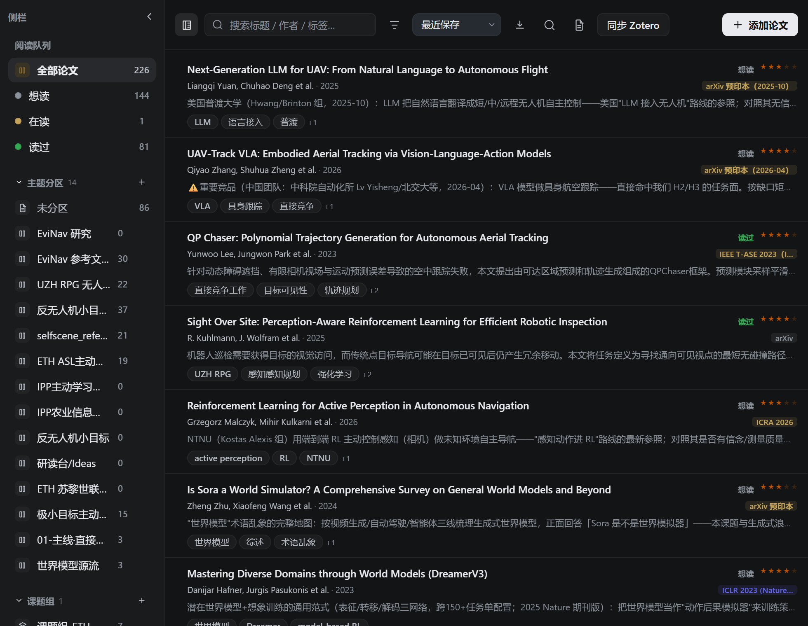

# dsh-papercover

[English](README.md) | [简体中文](README.zh.md)

A paper workbench for [DeepSeek Harness](https://www.npmjs.com/package/@deepseek-ai/dsh). Collect a paper, read it against the PDF, keep the claim, turn it into a card, attach it to a project, and connect it on the graph, all from the sidebar. The chat can pick up any of those steps.

A fresh install is empty. This repository and the release archive contain the plugin only. They do not include papers, PDFs, notes, reports, API keys, or anyone's library. After you install it, your own files are created on your machine, under the archive directory you choose in settings. The default directory is `~/Documents/ResearchPapers`, and it starts empty.

## Main screen



## Highlights

**It sits next to the chat.** Four pages live in the sidebar: Library, Graph, Cards, and Projects. Say “save this paper”, “read this closely”, or “turn the idea into a card”, and the agent files it, starts the reading, or creates the card. Close reading runs in the background, so the current chat stays free.

**A close reading you can check.** Three depths: full, light, and skim. A report keeps claims, evidence, experiments, figures, and limits. Each item is marked as a statement from the paper, an experimental number, a reader inference, or not enough material, and it links back to a page. Later questions use the saved text and come back with page sources. Compare 2–10 papers at once. Papers that already have a report can be compared again without a reread. You can also aim a pass at method, experiments, attribution, limits, or whether the idea transfers.

**The PDF stays in the sidebar.** Highlights, notes, word translation, and a page outline. A highlighted sentence jumps back to its page.

**The library is arranged like a reading list.** Collections, a queue (want to read / reading / done), a lifecycle from inbox to cited, tags, years, and saved filters. Paste an arXiv link or a DOI and the record fills in. Related papers, citations, and references come from OpenAlex. Copy a citation as GB/T 7714, APA 7, or BibTeX, or export the whole library as `.bib`.

**A paper can grow into a project.** A card holds the idea, one plain sentence, the steps, and the evidence. When you want to try it, the same card becomes a checkable hypothesis: question, modules to change, dataset, baseline, metrics, risks, and result. Evidence is its own record, attached to a paper, a card, or a project. A project gathers the papers, the evidence, the cards, and the problems still open.

**Ask the graph who used a method.** Papers and concepts connect as proposes, improves, builds on, uses, compares, or cites. Tags can sketch the first layer. The chat can add the semantic links after that.

**It meets Zotero and Obsidian where they already are.** Two-way sync with Zotero Desktop covers papers, collections, PDFs, notes, cards, and highlights. Steps are in [Zotero](#zotero). Notes and highlights can also be written into an Obsidian vault as Markdown, with YAML front matter and quoted passages.

Your files stay on your computer. The plugin collects no usage data of its own. Scanned PDFs without a text layer cannot be read. This plugin does not run OCR. Check model-written page numbers and claims against the PDF.

## Install

Requires DeepSeek Harness and Node.js 20 or newer.

From the release archive:

```sh
dsh plugin --profile web add ./dsh-papercover-0.3.3.tgz
```

From source:

```sh
git clone https://github.com/nulihou/dsh-papercover.git
cd dsh-papercover
npm ci
npm run build
dsh plugin --profile web add .
```

Quit DeepSeek Harness completely and open it again after installing or upgrading. Prefer a clone path that contains no spaces.

## Zotero

dsh-papercover syncs both ways with Zotero Desktop 10 or newer, through Zotero’s local connector. The default address is `http://127.0.0.1:23119/api`.

1. In Zotero, turn on **Allow other applications to communicate with Zotero**.
2. In dsh-papercover settings, under **Zotero sync**, choose **Authorize writes**.
3. In the Zotero dialog, choose **Always Allow**. A one-time Allow expires after the first write, so the rest of the library cannot be pushed.

The **Sync Zotero** button on the library runs both directions: pull from Zotero, then push local changes. Settings also has **Pull only** and **Push only**. Pull works without a write key. Push needs the key from step 2.

| What | Direction |
|---|---|
| Paper metadata: title, authors, year, venue, DOI, abstract, tags | Both |
| Collections (主题分区) | Both |
| PDF attachments | Both |
| Notes | Both |
| Idea cards | Both. Cards pushed from here land in a Zotero collection named `dsh-papercover/Ideas` |
| Highlights | Both. Zotero highlights on the PDF attachment come back onto the same pages |

A shorter collection name that is a prefix of a longer one is treated as the same collection. The longer name is kept, so the sidebar does not list both.

If the same paper was edited on both sides after the last sync, the newer edit is kept and the other side is counted as a conflict. The link between the two libraries is stored in `zotero-map.json` inside your archive directory. The write key stays in `~/.dsh/scholar-config.json` on your computer. Neither file is in this repository.

## Where data lives

| Item | Where it goes |
|---|---|
| Papers, PDFs, reports, questions, cards, graph | The archive directory on your computer |
| Metadata and citation links | arXiv, Crossref, and OpenAlex, when you ask for them |
| Close reading, questions, figure descriptions | The model configured in DeepSeek Harness |
| Settings, including the Zotero write key | `~/.dsh/scholar-config.json` on your computer |
| Zotero item map | `zotero-map.json` inside the archive directory |

The plugin has no telemetry of its own. `/scholar/*` routes accept loopback connections only.

## License

[MIT](LICENSE) · [Changelog](CHANGELOG.md)
