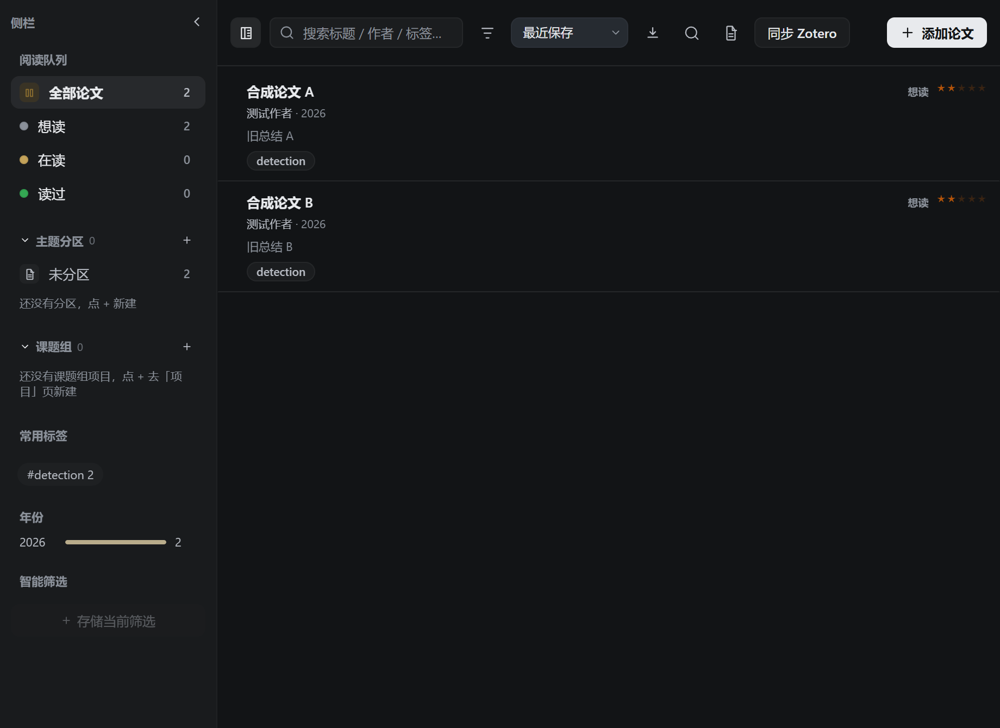
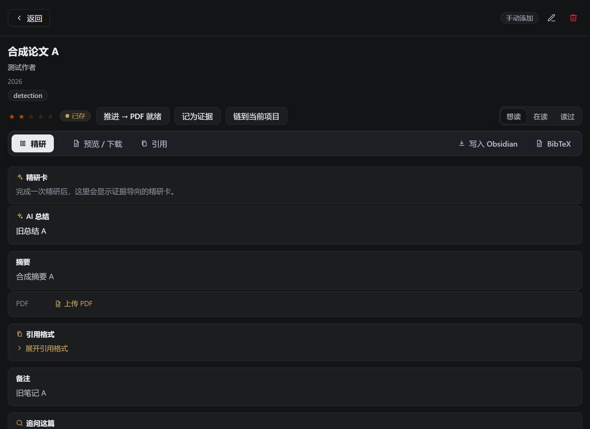
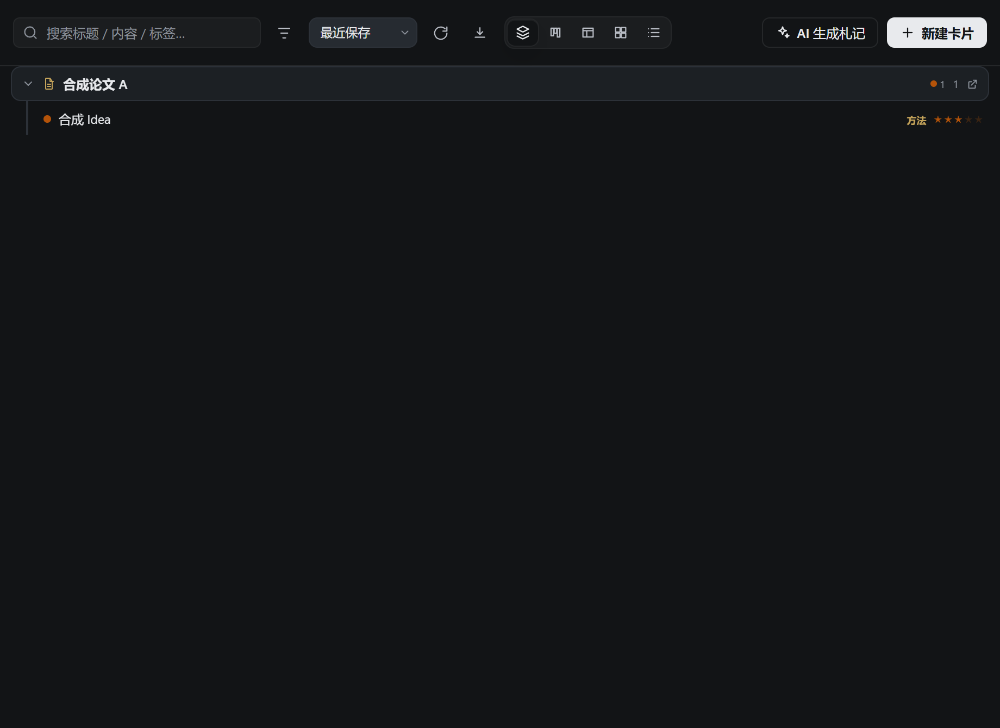
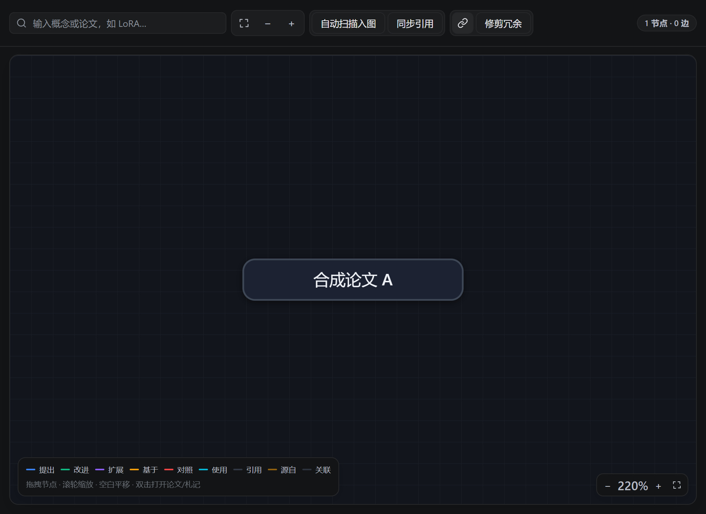

# dsh-papercover

[English](README.md) | [简体中文](README.zh.md)

Paper library and close-reading workspace for [DeepSeek Harness](https://www.npmjs.com/package/@deepseek-ai/dsh). Keep papers, PDFs, reading reports, questions, idea cards, and a knowledge graph in one sidebar.

A fresh install is empty. This repository and the release archive contain the plugin only. They do not include papers, PDFs, notes, reports, API keys, or anyone's library. After you install it, your own files are created on your machine, under the archive directory you choose in settings. The default directory is `~/Documents/ResearchPapers`, and it starts empty.

The pictures below use stand-in titles (`合成论文`), not a real library.

## Main screens

| Library | Paper |
|---|---|
|  |  |

| Notes | Graph |
|---|---|
|  |  |

## Install

Requires DeepSeek Harness and Node.js 20 or newer.

From the release archive:

```sh
dsh plugin --profile web add ./dsh-papercover-0.3.3.tgz
```

From source:

```sh
git clone https://github.com/nulihou/dsh-papercover.git
cd dsh-papercover
npm ci
npm run build
dsh plugin --profile web add .
```

Quit DeepSeek Harness completely and open it again after installing or upgrading. Prefer a clone path that contains no spaces.

## What you can do

- Save papers by hand, or ask the agent to call `paper_save`. arXiv ids, DOIs, and titles are used to spot duplicates.
- Upload a local PDF, or download the PDF for an arXiv paper. The upload limit is 50MB per file.
- Read in the sidebar: highlights, notes, word translation, and page outline.
- Run a close reading, a lighter synthesis, or a skim. Reports keep claims, evidence, experiments, figures, limits, and page links.
- Ask follow-up questions against the saved paper text.
- Compare several papers.
- Keep idea cards and a knowledge graph of papers, concepts, and ideas.
- Copy citations as GB/T 7714, APA, or BibTeX.

Scanned PDFs without a text layer cannot be read. This plugin does not run OCR. Check model-written page numbers and claims against the PDF.

## Where data lives

| Item | Where it goes |
|---|---|
| Papers, PDFs, reports, questions, cards, graph | The archive directory on your computer |
| Metadata and citation links | arXiv, Crossref, and OpenAlex, when you ask for them |
| Close reading, questions, figure descriptions | The model configured in DeepSeek Harness |
| Settings | `~/.dsh/scholar-config.json` on your computer |

The plugin has no telemetry of its own. `/scholar/*` routes accept loopback connections only.

## License

[MIT](LICENSE) · [Changelog](CHANGELOG.md)
